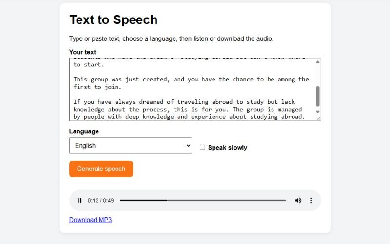

# Text to Speech Web App

A small web app that turns text into spoken audio. Type or paste text, choose a language, and listen instantly or download the result as an MP3.



## Features

- Type or paste up to 5,000 characters
- Choose from all languages supported by gTTS
- "Speak slowly" option
- Instant playback in the browser
- Download the audio as an MP3
- Clear error messages for empty text, text that is too long, and network failures

## Tech stack

- Python 3 and Flask (backend and a single `/speak` API route)
- gTTS (Google Text-to-Speech) for audio generation
- Plain HTML, CSS and JavaScript (frontend, using `fetch`)

## Run it locally

```bash
git clone https://github.com/Seepage/tts-app.git
cd tts-app
python -m venv venv
source venv/bin/activate        # Windows: venv\Scripts\activate
pip install -r requirements.txt
python app.py
```

Open http://127.0.0.1:5000 in your browser. An internet connection is needed because gTTS calls Google's speech service.

## How it works

1. The browser sends the text, language code and speed option to `POST /speak`.
2. The server validates the input and generates an MP3 in memory with gTTS.
3. The MP3 is returned to the browser, which plays it and offers a download link.

## Live demo

Add your deployed link here.

## What I learned

This was my first personal project. I learned how to build a Flask route, validate input, handle errors, and connect a JavaScript frontend to a Python backend.

## Next steps

I am extending this into an AI exam coach for JAMB/WAEC students, where the same text-to-speech feature reads step-by-step explanations aloud.
